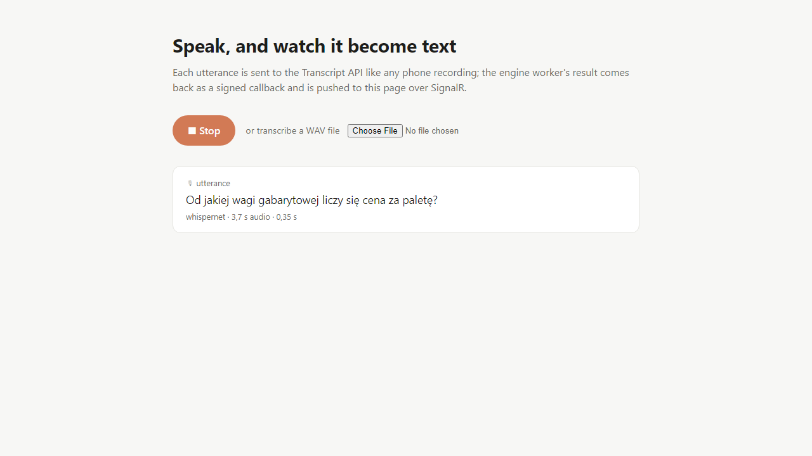
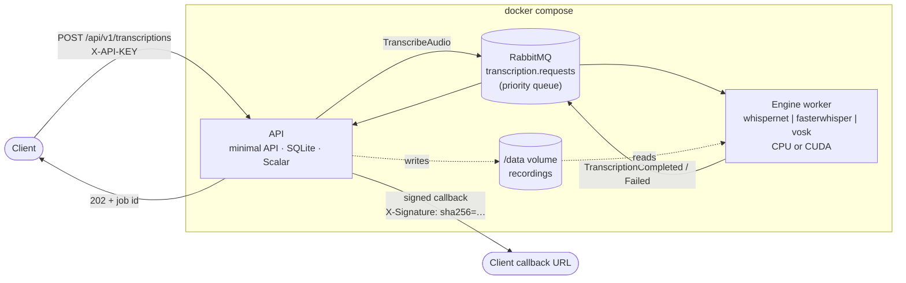

# TranscriptService

[](https://github.com/toper/TranscriptService/actions/workflows/ci.yml)

Offline speech-to-text for telephone recordings (WAV, 8 kHz, PCM16 or G.711, mono or stereo), built as
.NET 10 microservices: a REST API, a RabbitMQ queue and an engine worker of your choice — Whisper.net,
FasterWhisper.NET or Vosk — on CPU or an NVIDIA GPU.



## Architecture



1. The API checks the WAV header, stores the recording on a shared volume and records the job in SQLite.
   Short recordings (≤ 30 s) are queued with high priority.
2. One engine worker converts the audio to 16 kHz mono and transcribes it. The model is loaded once at
   startup and stays warm.
3. The API stores the result and POSTs it to the client's `callbackUrl`, signed with HMAC-SHA256. After a
   delivered callback the job and recording are deleted. Without a callback the result stays for 15 minutes.

Decisions and trade-offs are recorded as ADRs:
[EasyNetQ messaging](docs/adr/0001-messaging-with-easynetq.md) ·
[SQLite owned by the API](docs/adr/0002-sqlite-owned-by-the-api.md) ·
[recordings on a shared volume](docs/adr/0003-recordings-on-a-shared-volume.md) ·
[signed callbacks and short retention](docs/adr/0004-signed-callbacks-and-short-retention.md) ·
[container images](docs/adr/0005-container-images.md).

## Quick start

Requirements: Docker with Compose v2. For GPU, an NVIDIA GPU plus the
[NVIDIA Container Toolkit](https://docs.nvidia.com/datacenter/cloud-native/container-toolkit/).

```bash
cp deploy/.env.example deploy/.env      # set API_KEY and CALLBACK_SIGNING_SECRET
docker compose -f deploy/docker-compose.yml --profile whispernet up --build
```

The profile chooses the engine: `whispernet`, `fasterwhisper` or `vosk`. On first start a `models-init`
container downloads the model listed in [deploy/models/models.txt](deploy/models/models.txt) into a
volume and checks its SHA-256. The Whisper models are large, so the first start takes a while.

| URL | What |
|-----|------|
| http://localhost:8080/scalar/v1 | API reference (Scalar) |
| http://localhost:8081 | Microphone demo (with `--profile demo`) |
| http://localhost:15672 | RabbitMQ management UI (published on localhost only) |

On an NVIDIA GPU, add the GPU override:

```bash
docker compose -f deploy/docker-compose.yml -f deploy/docker-compose.gpu.yml --profile whispernet up --build
```

To run the demo page, add its profile: `--profile whispernet --profile demo`.

## Engines

| Engine | Profile | CPU | GPU | Default model | Timed segments |
|--------|---------|-----|-----|---------------|----------------|
| [Whisper.net](https://github.com/sandrohanea/whisper.net) | `whispernet` | ✓ | CUDA 13 | `ggml-large-v3-turbo-q5_0` | phrases |
| [FasterWhisper.NET](https://github.com/qourex/FasterWhisper.NET) | `fasterwhisper` | ✓ (slow) | CUDA 12 + cuDNN | `faster-whisper-large-v3-turbo` | phrases |
| [Vosk](https://alphacephei.com/vosk/) | `vosk` | ✓ | – | `vosk-model-small-pl-0.22` | single words |

Notes from testing on real 8 kHz call recordings:

- **Whisper.net** is the default choice. It works well on both CPU and GPU. On a GPU a short call takes about 0.2 s.
- **FasterWhisper.NET** is meant for GPU, where a short call takes about 0.3 s. Its CPU build can only use
  `float32`, which makes it much slower than Whisper.net on CPU. Its voice activity filter
  (`Engine__VadEnabled`) is off by default, because it removes speech from 8 kHz audio.
- **Vosk** is the light option for CPU only, at about 0.3 s per short call. It returns a timestamp for each
  word. One model covers one language, set in `VOSK_MODEL_LANGUAGE`; a request for any other language is
  rejected with a clear message.

You can run more than one worker on the same queue, for example a GPU worker and a CPU worker side by
side. Each job is processed by whichever worker is free.

## Using the API

Every `/api/v1` request needs the `X-API-KEY` header. The full contract, with examples, is at
`/scalar/v1`. The OpenAPI document is at `/openapi/v1.json`.

```bash
# Submit a recording (multipart: audio, optional language and callbackUrl)
curl -i -H "X-API-KEY: $API_KEY" \
     -F "audio=@call.wav;type=audio/wav" -F language=pl \
     -F callbackUrl=https://example.com/transcripts \
     http://localhost:8080/api/v1/transcriptions
# HTTP/1.1 202 Accepted
# Location: /api/v1/transcriptions/01a19420-1f39-7dc1-a424-76de6b51984e

# Poll the job (or wait for the callback)
curl -H "X-API-KEY: $API_KEY" http://localhost:8080/api/v1/transcriptions/01a19420-1f39-7dc1-a424-76de6b51984e
```

```json
{
  "id": "01a19420-1f39-7dc1-a424-76de6b51984e",
  "status": "Completed",
  "language": "pl",
  "createdAt": "2026-10-31T22:41:35.5451+00:00",
  "finishedAt": "2026-10-31T22:41:42.8215+00:00",
  "engine": "whispernet",
  "fullText": "w rejonie ulic Konarskiego oraz Kociuszki odnotomano Amarie Zasilania. Przewidywany czas przywrócenia zasilania to 14.45. Za utrudnienia przepraszamy.",
  "segments": [
    { "text": "w rejonie ulic Konarskiego oraz Kociuszki odnotomano Amarie Zasilania.", "start": "00:00:00", "end": "00:00:05.2400000" }
  ],
  "failureReason": null,
  "audioDuration": "00:00:14.1565625",
  "processingTime": "00:00:07.2669445"
}
```

This is real output for the synthetic test recording `tests/TestData/sample.wav` (eSpeak voice), from the
CPU image. Real voices are recognized more accurately, and a GPU is much faster.

`DELETE /api/v1/transcriptions/{id}` removes a job and its recording early. Errors are returned as RFC 9457
problem details:
- `400`: not a supported WAV, empty, or too long (the limit is 30 minutes).
- `413`: the upload is over 100 MB.
- `503`: the queue is unavailable.

### Callbacks

When a job finishes, the API POSTs the same JSON to the `callbackUrl`, with two headers:
- `X-Transcription-Id`: the job id.
- `X-Signature: sha256=<hex>`: an HMAC-SHA256 of the raw body, keyed with `CALLBACK_SIGNING_SECRET`.

Failed deliveries are retried with backoff. Callbacks to private and loopback addresses are blocked unless
the host is on `Api__AllowedCallbackHosts` or `ALLOW_PRIVATE_CALLBACKS=true`.

To verify a callback in ASP.NET Core:

```csharp
var secret = app.Configuration["CallbackSigningSecret"]!;

app.MapPost("/transcripts", async (HttpRequest request) =>
{
    using var buffer = new MemoryStream();
    await request.Body.CopyToAsync(buffer);
    var body = buffer.ToArray();

    var expected = "sha256=" + Convert.ToHexStringLower(
        HMACSHA256.HashData(Encoding.UTF8.GetBytes(secret), body));
    if (!CryptographicOperations.FixedTimeEquals(
            Encoding.ASCII.GetBytes(expected),
            Encoding.ASCII.GetBytes(request.Headers["X-Signature"].ToString())))
    {
        return Results.Unauthorized();
    }

    var transcript = JsonSerializer.Deserialize<TranscriptionResponse>(body, JsonSerializerOptions.Web);
    // ... store or forward the transcript
    return Results.Ok();
});
```

.NET receivers can reference `TranscriptService.Contracts` and call `CallbackSigner.Verify(body, signature, secret)`
instead. The demo backend does this in
[DemoEndpoints.cs](src/TranscriptService.Demo.Web/Transcriptions/DemoEndpoints.cs).

## Configuration

`deploy/.env` (copied from [.env.example](deploy/.env.example)):

| Variable | Default | Meaning |
|----------|---------|---------|
| `API_KEY` | – | Key for the `X-API-KEY` header (≥ 16 characters) |
| `CALLBACK_SIGNING_SECRET` | – | HMAC secret for callback signatures (≥ 32 characters) |
| `ALLOW_PRIVATE_CALLBACKS` | `false` | Allow callbacks to any private network address |
| `WHISPERNET_MODEL` | `whispernet/ggml-large-v3-turbo-q5_0.bin` | Model path inside the models volume |
| `FASTERWHISPER_MODEL` | `fasterwhisper/large-v3-turbo` | Model directory inside the models volume |
| `VOSK_MODEL` | `vosk/small-pl` | Model directory inside the models volume |
| `VOSK_MODEL_LANGUAGE` | `pl` | Language of the Vosk model |

Other settings use standard .NET configuration and can be set as environment variables in compose:

| Setting | Default | Meaning |
|---------|---------|---------|
| `Api__DefaultLanguage` | `pl` | Language used when a request does not give one |
| `Api__MaxUploadBytes` / `Api__MaxAudioDuration` | 100 MB / `00:30:00` | Upload limits |
| `Api__ResultTtl` | `00:15:00` | How long a result stays without a callback |
| `Api__HighPriorityThreshold` | `00:00:30` | Recordings up to this length jump the queue |
| `Api__AllowedCallbackHosts__0` | – | Host allowed as a callback target even on a private network |
| `Engine__Device` | `Cpu` / `Cuda` | Set by the image target (`runtime-cpu` / `runtime-cuda`) |
| `Engine__Threads` (Whisper.net), `Engine__CpuThreads` (FasterWhisper) | CPU cores, at most 8 | CPU threads |
| `Engine__BeamSize`, `Engine__ComputeType`, `Engine__VadEnabled` | `1`, auto, `false` | FasterWhisper tuning |

All services log JSON to stdout (NLog). Each one serves `/health/live` and `/health/ready`, and the
images use these for their `HEALTHCHECK`.

## Repository layout

```
src/
  TranscriptService.Api                 REST API, SQLite job store, callbacks, retention
  TranscriptService.Contracts           Messages, HTTP DTOs, callback signing (shared with clients)
  TranscriptService.Audio               WAV inspection and conversion to 16 kHz mono float
  TranscriptService.ServiceDefaults     Logging, health checks, EasyNetQ wiring
  TranscriptService.Worker.Core         ITranscriber, job handler, worker host
  TranscriptService.Worker.WhisperNet   Whisper.net engine
  TranscriptService.Worker.FasterWhisper FasterWhisper.NET engine
  TranscriptService.Worker.Vosk         Vosk engine
  TranscriptService.Demo.Web(.Client)   Blazor microphone demo + SignalR backend
tests/                                  xUnit v3 on Microsoft.Testing.Platform
deploy/                                 Compose files, worker Dockerfile, model download
docs/                                   Design, plan, ADRs
```

Every engine implements only `ITranscriber` (load the model once, then transcribe 16 kHz samples).
Queueing, audio conversion, error reporting and graceful shutdown live once, in `Worker.Core`.

## Building and testing

```bash
dotnet build TranscriptService.slnx -c Release   # warnings are errors
dotnet test --solution TranscriptService.slnx
```

- Unit tests and API tests run anywhere.
- `TranscriptService.IntegrationTests` starts RabbitMQ with Testcontainers, so it needs Docker.
- Engine tests use real models and are skipped unless `MODELS_DIR` points to a folder laid out like
  `deploy/models/models.txt`:

```bash
MODELS_DIR=$PWD/models dotnet test --solution TranscriptService.slnx
```

CI builds and tests the solution, then builds every image (API, demo, and each engine on CPU and CUDA).

## License

[GPL-3.0](LICENSE.txt)
